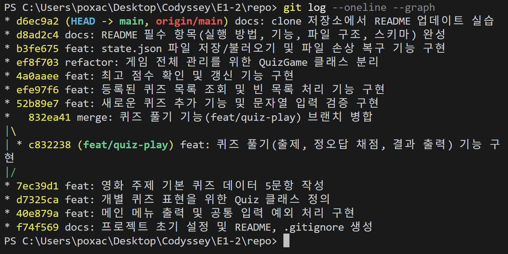
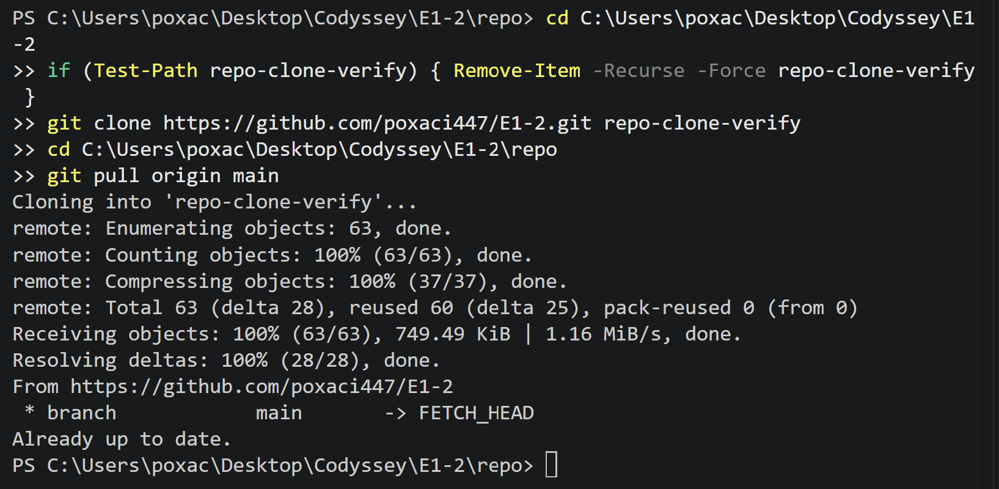

# 나만의 영화 퀴즈 게임

## 1. 프로젝트 개요
Python의 객체지향 프로그래밍(클래스 설계)과 JSON 기반 파일 입출력(데이터 영속성), 그리고 Git 브랜치 협업 워크플로우를 익히기 위해 제작한 터미널 기반 영화 퀴즈 게임입니다.

- **원격 저장소 (GitHub)**: https://github.com/poxaci447/E1-2

## 2. 퀴즈 주제와 선정 이유
- **주제**: 국내외 명작 영화 (감독, 등장인물, 명대사, 개봉 정보 등)
- **선정 이유**: 대중적으로 친숙하여 누구나 흥미롭게 퀴즈를 풀 수 있고, 시리즈물이나 감독·배우 등 파생 데이터를 기반으로 새로운 퀴즈를 확장 등록하기에 적합하기 때문입니다.

## 3. 실행 방법
Python 3.10 이상 환경에서 외부 라이브러리 설치 없이 바로 실행할 수 있습니다.

```bash
python main.py
```

## 4. 기능 목록
1. **퀴즈 풀기**: 등록된 영화 퀴즈를 순서대로 출제하고 정오답 여부와 최종 점수(100점 환산)를 출력합니다.
2. **퀴즈 추가**: 문제, 4개의 선택지, 정답 번호(1~4)를 입력받아 새 퀴즈를 등록하고 즉시 파일에 저장합니다.
3. **퀴즈 목록**: 현재 저장된 모든 퀴즈의 번호와 문제 내용을 조회합니다.
4. **점수 확인**: 역대 최고 점수를 확인합니다. 아직 퀴즈를 풀지 않은 경우 안내 메시지를 출력합니다.
5. **입력 및 예외 처리**:
   - 입력값 앞뒤 공백 제거, 빈 입력, 문자 입력, 허용 범위 밖 숫자 입력 시 안내 후 재입력을 유도합니다.
   - `Ctrl+C`(`KeyboardInterrupt`) 및 `EOFError` 발생 시 데이터를 저장하고 안전하게 종료합니다.
   - `state.json` 파일이 없거나 손상된 경우 백업 후 사용자 선택에 따라 기본 영화 퀴즈 5문항으로 복구합니다.

## 5. 파일 구조 및 변경 시 수정 대상 메서드 매핑

```text
repo/
├── main.py          # 프로그램 실행 진입점
├── quiz.py          # 개별 퀴즈(Quiz) 클래스 및 기본 영화 퀴즈 5문항
├── quiz_game.py     # 게임 흐름 관리(QuizGame) 클래스 및 JSON 파일 입출력
├── state.json       # 퀴즈 목록 및 최고 점수 저장 파일 (실행 시 자동 생성)
├── screenshot/      # 개발 환경, 실행 화면, Git 로그 및 clone/pull 캡처 이미지
├── .gitignore       # Git 추적 제외 설정
└── README.md        # 프로젝트 설명 문서
```

### 요구사항 변경 시 수정 대상 파일 및 메서드 매핑
| 변경 요구사항 예시 | 수정 대상 파일 | 관련 클래스 / 메서드 |
| :--- | :--- | :--- |
| 선택지 개수 변경(예: 4지선다 → 5지선다), 힌트 필드 추가 | `quiz.py` | `Quiz.__init__`, `Quiz.display`, `Quiz.to_dict`, `Quiz.from_dict`, `get_default_quizzes` |
| 정답 판정 로직 변경 (복수 정답, 부분 점수 등) | `quiz.py`, `quiz_game.py` | `Quiz.check_answer`, `QuizGame.play_quiz` |
| 숫자·문자열 입력 검증 기준 또는 안내 문구 변경 | `quiz_game.py` | `QuizGame.get_valid_number`, `QuizGame.get_non_empty_text` |
| 메뉴 항목 추가(예: 퀴즈 삭제, 점수 히스토리) | `quiz_game.py` | `QuizGame.print_menu`, `QuizGame.run` (+ 신규 기능 메서드) |
| 퀴즈 등록 절차 및 유효성 규칙 변경 | `quiz_game.py` | `QuizGame.add_quiz` |
| 목록/점수 출력 포맷 변경 | `quiz_game.py` | `QuizGame.show_quiz_list`, `QuizGame.show_best_score` |
| 저장 파일 경로, 스키마 구조, 백업·복구 정책 변경 | `quiz_game.py` | `QuizGame.__init__`, `QuizGame.load_state`, `QuizGame.save_state`, `QuizGame._backup_corrupted_state`, `QuizGame._handle_corrupted_state` |
| 프로그램 실행 인자(CLI 옵션) 추가 | `main.py` | `main` |

## 6. 데이터 파일 설명 (`state.json`), 복구 절차 및 한계

### 6-1. 파일 경로 및 스키마
- **경로**: 프로젝트 루트 디렉터리 (`./state.json`, UTF-8 인코딩)
- **역할**: 프로그램 종료 후 재실행해도 사용자가 추가한 퀴즈와 최고 점수가 유지되도록 상태를 영구 저장합니다.
- **스키마 구조**:
  - `quizzes` (list): 퀴즈 객체 목록 (`question`: 문자열, `choices`: 4개 보기 리스트, `answer`: 1~4 정수)
  - `best_score` (int | null): 최고 점수 (미풀이 상태는 `null`)

```json
{
  "quizzes": [
    {
      "question": "영화 '기생충'의 감독은?",
      "choices": ["박찬욱", "봉준호", "나홍진", "이창동"],
      "answer": 2
    }
  ],
  "best_score": 100
}
```

### 6-2. 데이터 손상 감지 시 백업 및 복구 절차
1. `QuizGame.load_state()` 실행 중 JSON 문법 오류(`JSONDecodeError`), 스키마 검증 실패(`ValueError`), 읽기 오류(`OSError`)가 감지되면 `_handle_corrupted_state()`를 호출합니다.
2. `_backup_corrupted_state()`가 손상된 원본 `state.json`을 `state.json.bak_YYYYMMDD_HHMMSS` 형식의 타임스탬프 파일로 복사해 이전 버전을 보존합니다.
3. 사용자에게 복구 선택지를 제공합니다:
   - **1번 (초기화 후 계속)**: 기본 영화 퀴즈 5문항(`get_default_quizzes()`)과 `best_score: null`로 초기화한 뒤 `save_state()`로 정상 JSON 파일을 재생성합니다.
   - **2번 (덮어쓰지 않고 종료)**: 기존 파일을 수정하지 않고 안전 종료하여 사용자가 백업 파일을 직접 열어 수동 복구할 수 있도록 합니다.

### 6-3. JSON 파일 저장 방식의 한계와 대안
소규모 개인 CLI 프로그램에서는 표준 라이브러리(`json`)만으로 직관적인 영속성을 확보할 수 있지만, 데이터가 커지면 다음 한계가 발생합니다.
- **성능(I/O) 부담**: 퀴즈 1개만 추가하거나 점수만 갱신해도 전체 `state.json` 파일을 매번 처음부터 다시 직렬화해 덮어써야 합니다.
- **메모리 부담**: 프로그램 시작 시 파일 전체를 메모리에 적재(`json.load`)하므로 수십만 건 이상의 대량 데이터에서는 메모리 사용량과 로딩 시간이 급격히 증가합니다.
- **검색·동시성 한계**: 인덱스 기반 조건 검색이나 정렬이 비효율적이며, 여러 프로세스/사용자가 동시에 쓰기를 시도할 때 파일 잠금(Lock)이나 트랜잭션이 없어 데이터 손상이 발생할 수 있습니다.
- **대안**: 로컬 환경에서 중규모 이상으로 확장할 경우 파이썬 내장 **`SQLite`**(관계형 경량 DB)로 전환해 트랜잭션·인덱스·부분 갱신을 지원할 수 있으며, 다중 사용자 웹 서비스로 확장 시 **PostgreSQL/MySQL(RDBMS)** 또는 **MongoDB(NoSQL)** 도입이 적합합니다.

## 7. 객체지향(클래스) 설계 채택 이유
본 프로젝트는 개별 데이터를 다루는 `Quiz` 클래스와 전체 상태·흐름을 제어하는 `QuizGame` 클래스로 책임을 분리했습니다.

- **채택 이유**:
  - **상태와 동작의 캡슐화**: 퀴즈 목록(`self.quizzes`), 최고 점수(`self.best_score`), 저장 경로(`self.state_file`)와 이를 다루는 메서드를 한 객체 안에 묶어 전역 변수 오염을 방지합니다.
  - **역할 분리와 유지보수성**: 문제 1개의 표현·검증(`Quiz`)과 게임 루프·파일 I/O(`QuizGame`)가 분리되어 기능 확장(예: 힌트 추가, 다중 게임 세션) 시 수정 범위가 명확합니다.
  - **테스트 용이성**: `QuizGame(state_path="test_state.json")`처럼 저장 경로를 주입해 독립된 인스턴스로 단위 테스트를 수행하기 쉽습니다.
- **함수형/절차형 대안 대비 장단점**:
  - **함수형/절차형 장점**: 초기 코드량이 적고 단순한 스크립트에서는 데이터 흐름을 빠르게 파악할 수 있습니다.
  - **함수형/절차형 단점**: 기능이 늘어나면 `quizzes`, `best_score`, `state_file` 등을 모든 함수의 매개변수로 반복 전달하거나 전역 변수에 의존해야 해 결합도가 높아지고 유지보수가 어려워집니다.

## 8. Git 워크플로우, 커밋 규칙 및 브랜치 전략

### 8-1. 커밋 단위 및 메시지 규칙 (Conventional Commits)
- **커밋 분할 기준**: 하나의 커밋에는 하나의 독립된 기능·수정·문서 변경만 포함하여, 문제 발생 시 특정 변경만 안전하게 되돌릴(`revert`) 수 있도록 관리합니다.
- **메시지 템플릿**: `<type>: <변경 내용 요약>`
  - `feat`: 새로운 기능 추가 (예: `feat: 새로운 퀴즈 추가 기능 및 문자열 입력 검증 구현`)
  - `fix`: 버그 수정 (예: `fix: 점수 계산 오류 수정`)
  - `refactor`: 동작 변화 없는 코드 구조 개선 (예: `refactor: 게임 전체 관리를 위한 QuizGame 클래스 분리`)
  - `docs`: `README.md` 및 스크린샷 등 문서 작업 (예: `docs: README 필수 항목 완성`)
  - `chore`: `.gitignore`, 파일명 정리 등 설정·잡무
  - `merge`: 브랜치 병합 기록

### 8-2. 브랜치 분리 이유와 병합 시 고려사항
- **브랜치 분리 목적**:
  - **기능 개발 (`feat/*`)**: `main` 브랜치의 안정적인 동작 버전을 보호하면서 새로운 기능(예: `feat/quiz-play`)을 독립적으로 개발·검증합니다.
  - **버그 수정 (`fix/*`)**: 운영/배포 코드에 영향 없이 오류 원인을 격리해 수정합니다.
  - **실험 (`experiment/*`)**: 구조 변경이나 보너스 기능 프로토타입을 자유롭게 시도하고 실패 시 손쉽게 폐기합니다.
- **병합(`merge`)의 의미와 고려사항**:
  - 검증이 끝난 작업 브랜치의 변경 사항을 기준 브랜치(`main`)에 통합해 공식 이력으로 확정하는 과정입니다.
  - 병합 전 테스트를 통과했는지 확인하고, 동일 파일 수정으로 인한 **충돌(Conflict)** 여부를 점검합니다.
  - 본 프로젝트에서는 `git merge --no-ff` 옵션을 사용해 브랜치 분기·통합 이력이 그래프(`git log --graph`)에 명확히 남도록 관리했습니다.

## 9. 저장소 및 Git 워크플로우 증빙

### 9-1. 원격 저장소 및 10회 이상 커밋 / 브랜치 병합 이력
- **GitHub URL**: https://github.com/poxaci447/E1-2
- **브랜치 목록 (`git branch -a`)**: `main`, `feat/quiz-play`, `remotes/origin/main`
- **주요 커밋 및 병합 그래프 (`git log --oneline --graph`)**:

```text
* (여기에 최신 git --no-pager log --oneline --graph 출력을 붙여넣으세요)
```



### 9-2. `git clone` 및 `git pull` 복제·동기화 실습 증빙
별도 로컬 디렉터리에 저장소를 `clone`하여 변경 사항을 `commit`/`push`한 뒤, 기존 로컬 작업 저장소에서 `git pull origin main`으로 정상 반영됨을 확인했습니다.

```powershell
# 복제 및 동기화 검증 명령
git clone [https://github.com/poxaci447/E1-2.git](https://github.com/poxaci447/E1-2.git) repo-clone
git pull origin main
```



> Git clone/pull 워크플로우 실습 완료